# Architecture and Object-Oriented Design

Companion to `PLAN.md`. Stack: Python 3.11+, DuckDB (system of record), Apache Jena Fuseki on TDB2 (knowledge graph), local embeddings (semantic path), FastAPI + Streamlit (interfaces).

Diagrams are Mermaid and render on GitHub and in VS Code.

---

## 1. Architecture overview

### 1.1 Layers

| Layer | Responsibility | Components |
|---|---|---|
| **Sources** | Raw files and pages, untouched | ABR XML, ASIC CSVs, GLEIF L1/L2, ACCC HTML, ARTG CSVs, annual report PDFs, Wikidata SPARQL |
| **Ingestion** | Parse, validate, hash, stage; never mutates raw data | Source adapters, identifier validators, name normaliser |
| **Storage** | Durable state | DuckDB (records, canonical parties, candidates, links, labels), Fuseki/TDB2 (RDF graph per named graph), vector index (name embeddings) |
| **Resolution** | Candidate generation, scoring, arbitration, decision | Exact path, blocking + semantic path, arbiter, threshold policy |
| **Graph publishing** | DuckDB → RDF → Fuseki, then SHACL validation | RDF exporter, graph loader, SHACL validator |
| **Services** | Read-side logic an agent or UI calls | `ResolveService`, `ProjectionService`, `TraversalService` |
| **Interfaces** | Delivery | FastAPI (agent tool), Streamlit demo, CLI |

### 1.2 Component diagram

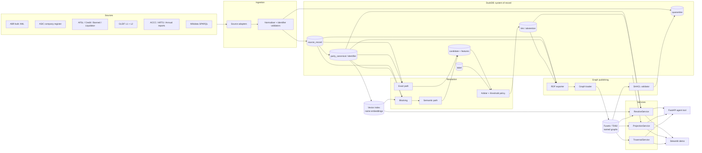

### 1.3 Store responsibilities

| Store | Owns | Never holds | Rebuilt from |
|---|---|---|---|
| DuckDB | Truth: raw source records, canonical parties, every candidate with features, links per matcher version, labels, quarantine | Nothing derived from Fuseki | Raw source files |
| Fuseki/TDB2 | Graph view: parties, reified facts, provenance, links per version, ontology | Unresolved candidates, features, labels | DuckDB (export + load) |
| Vector index | Embeddings of normalised canonical names | Anything authoritative | `party_canonical` |

**Consistency rule:** data flows one way, DuckDB → Fuseki. Fuseki is disposable, so if it disagrees with DuckDB you rebuild the affected named graph. Every Fuseki write is a whole-graph `PUT` derived from a DuckDB snapshot, so partial states are never exposed.

### 1.4 Key DuckDB tables

| Table | Key columns | Purpose |
|---|---|---|
| `source_snapshot` | source, snapshot_date, file_hash, records_in | One row per ingested file |
| `source_record` | source, record_id, content_hash, snapshot_date, payload (JSON), name_raw, name_norm, abn, acn, lei, licence_no | Immutable raw records; PK (source, record_id, content_hash) |
| `party_canonical` | canonical_key, party_type, name, name_norm, abn, acn, lei, status, state, anzsic, valid_from, valid_to | Tier 1 backbone |
| `identifier` | canonical_key, scheme, value | ABN / ACN / LEI / licence numbers, unique per (scheme, value) |
| `quarantine` | source, record_id, invariant, detail, detected_at | Invariant violations (e.g. ACN under two names) |
| `candidate` | run_id, source, record_id, canonical_key, path, features (JSON), score | **Every** scored pair, kept for recalibration |
| `matcher_version` | version, code_hash, policy (JSON), created_at | What produced each link |
| `link` | link_id, matcher_version, source, record_id, canonical_key, match_type, confidence, evidence (JSON) | Accepted links |
| `abstention` | matcher_version, source, record_id, best_candidate, best_score, reason | Refused links |
| `label` | sample_id, source, record_id, canonical_key, is_match, labeller, notes | Hand labels |

---

## 2. Workflows

### 2.1 Ingestion (runs per source, weekly for ABR)

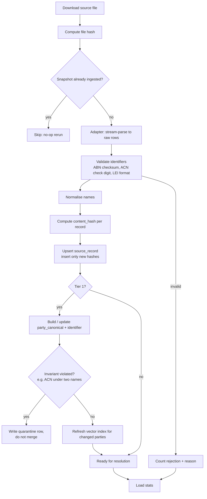

**Idempotency:** the file hash short-circuits identical reruns; content hashes mean a changed file only inserts changed records. Rerun cost = hash the file (seconds) if unchanged, otherwise parse + diff.

### 2.2 Resolution (batch, per non-Tier-1 source)

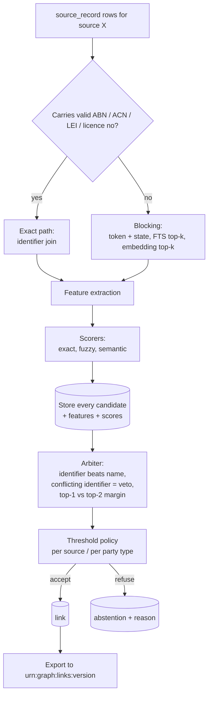

### 2.3 Graph publishing

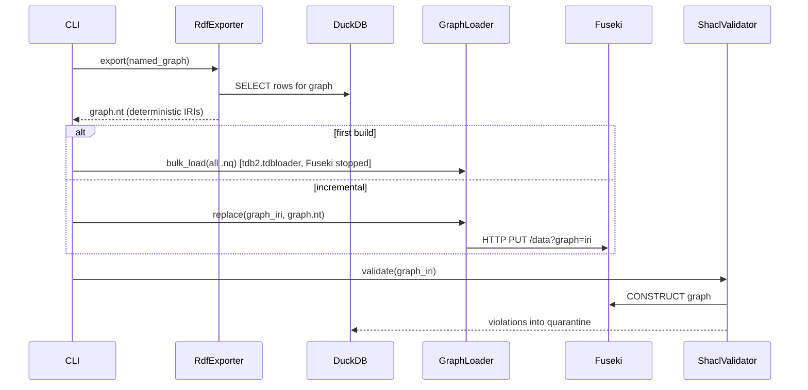

### 2.4 Recalibration (WRITEUP Q4)

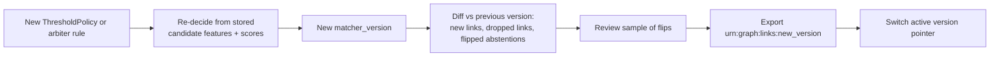

No re-matching of the corpus is needed unless **features** change. If a new feature is added, only candidates in the affected score band are rescored.

### 2.5 `resolve` request

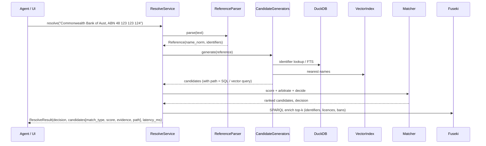

### 2.6 Projection (selection criteria → dataset)

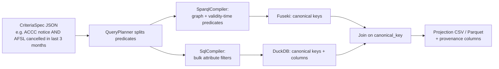

### 2.7 Ultimate parent traversal

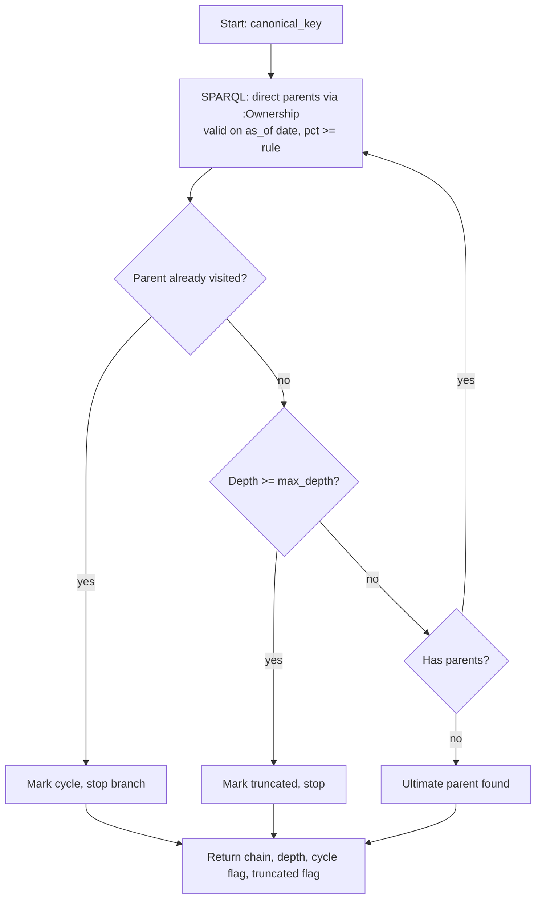

---

## 3. Object-oriented design

### 3.1 Package layout

```
src/bizgraph/
  config.py            Settings
  domain/              Party, Organisation, Person, Identifier, Fact subclasses, SourceRecord
  sources/             SourceAdapter + one adapter per source, SourceRegistry
  normalise/           NameNormaliser, IdentifierValidator subclasses
  store/               DuckDBStore, FusekiClient, VectorIndex, repositories
  rdf/                 Vocabulary, IriFactory, RdfExporter, GraphLoader, ShaclValidator
  pipeline/            IngestionPipeline, PublishPipeline, LoadReport
  resolution/          CandidateGenerator, Blocker, FeatureExtractor, Scorer, Arbiter,
                       ThresholdPolicy, Matcher, MatcherVersion, Link, Abstention
  evaluation/          LabelSampler, Evaluator, Metrics
  services/            ResolveService, ProjectionService, TraversalService, TraversalBudget
  api/                 FastAPI app
  cli.py               Entry points
demo/app.py            Streamlit
```

### 3.2 Domain model (mirrors the ontology)

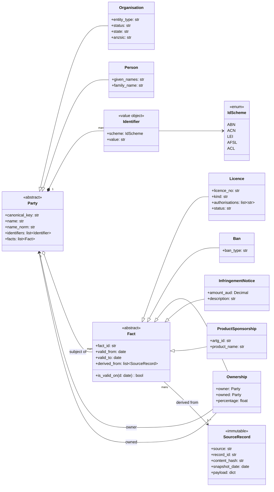

`Fact` is the in-code equivalent of a reified edge in the ontology: anything with its own attributes or validity period. **Extension point:** a new relationship type is a new `Fact` subclass plus an ontology subclass; nothing else changes.

### 3.3 Ingestion and publishing

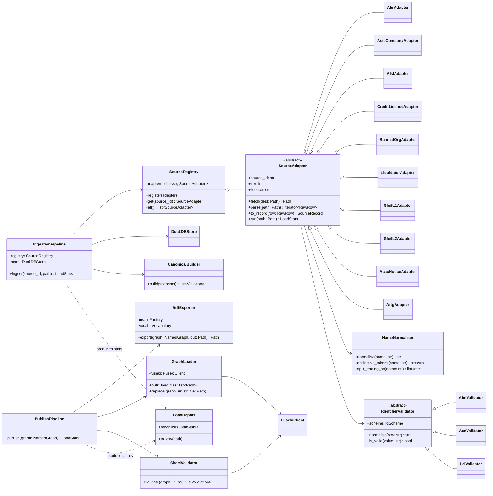

`SourceAdapter.run()` is a **template method**: fetch → parse → validate → normalise → hash → store is fixed, and subclasses only implement `parse` and `to_record`. **Extension point:** a new source is a new adapter registered in `SourceRegistry`.

### 3.4 Storage access

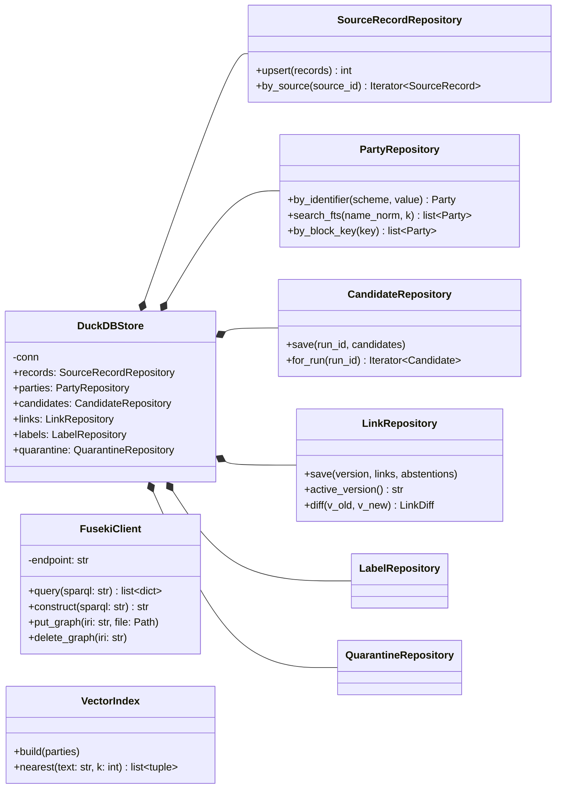

### 3.5 Resolution

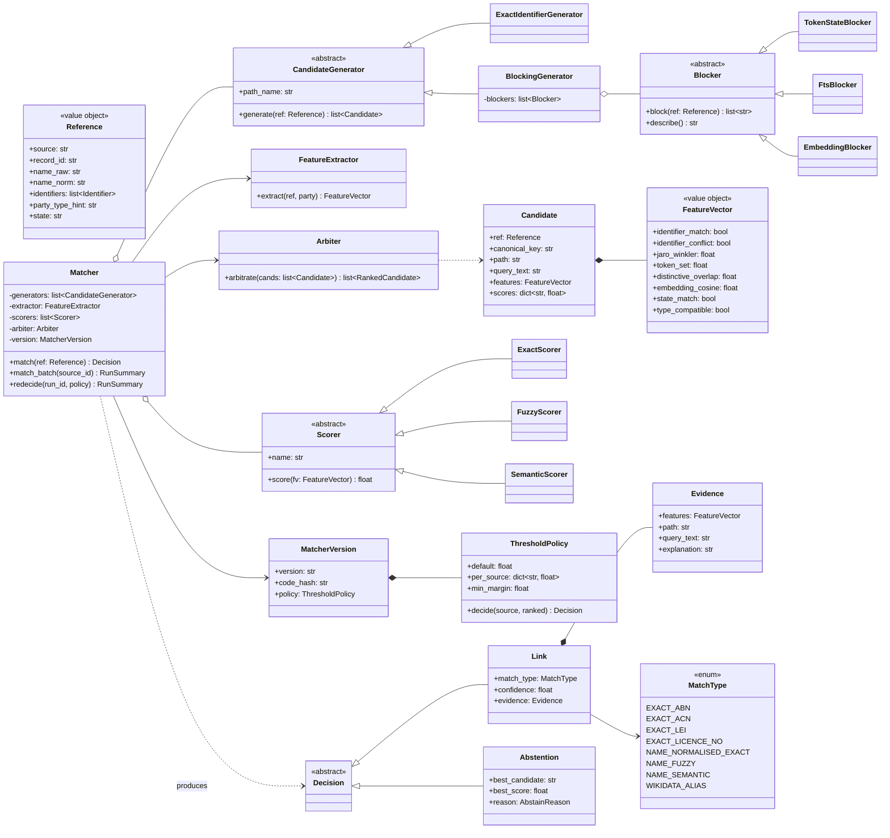

Patterns:
- **Strategy:** `Blocker`, `Scorer` and `CandidateGenerator` are swappable, so exact and semantic stay two named paths.
- **Facade:** `Matcher` is the single entry point for both batch resolution and `resolve`, so both use identical logic and thresholds.
- **Separation of scoring from deciding:** `Matcher.redecide()` reapplies a new `ThresholdPolicy` to stored `Candidate` features without regenerating candidates (WRITEUP Q4).

### 3.6 Evaluation

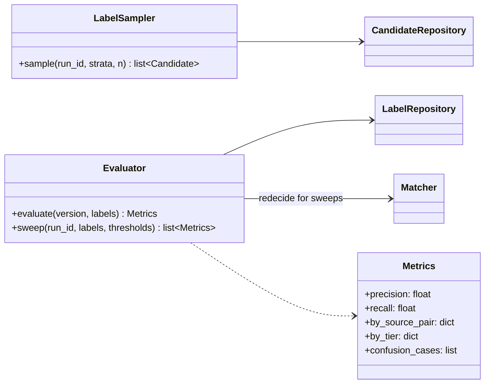

### 3.7 Services

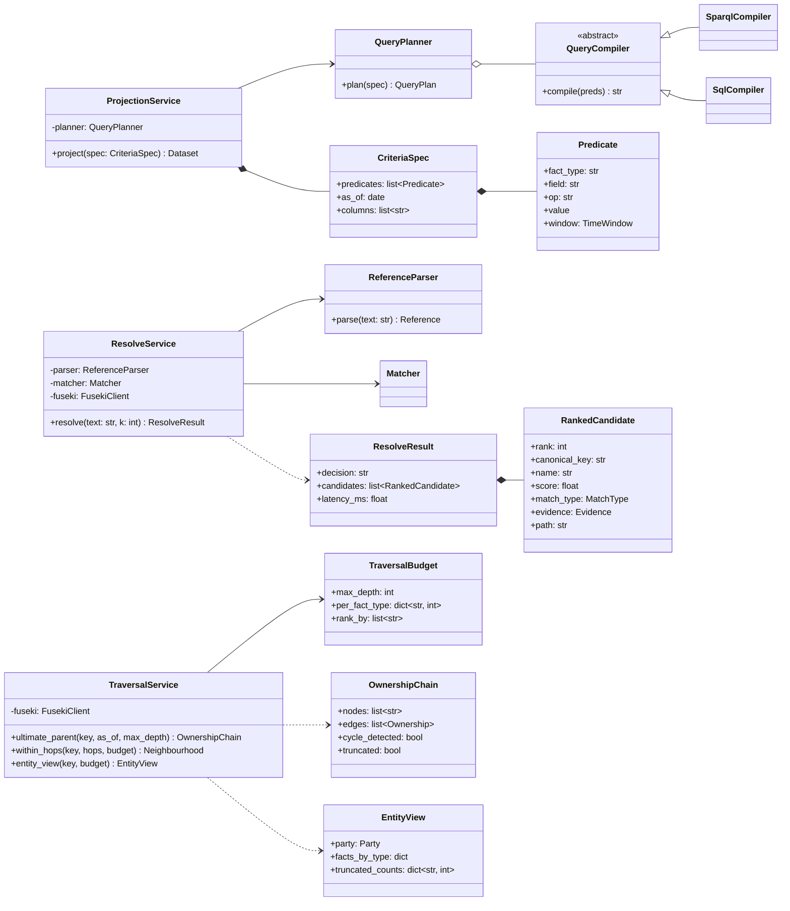

`TraversalBudget` implements the "cap what a traversal returns" requirement: each fact type gets a quota, items are ranked (active before historical, regulatory before products, recent first), and `EntityView.truncated_counts` tells the agent what was dropped.

---

## 4. Traceability to the plan

| FR | Main classes |
|---|---|
| FR0 Foundations | `Settings`, `SourceAdapter.fetch`, `SourceRegistry` |
| FR1 Ontology | `Vocabulary`, `domain/*`, `ontology/schema.ttl`, `ontology/shapes.ttl` |
| FR2 Load | `IngestionPipeline`, `CanonicalBuilder`, `RdfExporter`, `GraphLoader`, `ShaclValidator`, `LoadReport` |
| FR3 Resolution | `Matcher`, generators, blockers, scorers, `Arbiter`, `ThresholdPolicy`, `LinkRepository` |
| FR4 Evaluation | `LabelSampler`, `Evaluator`, `Metrics` |
| FR5 resolve | `ResolveService`, `ReferenceParser`, `ResolveResult` |
| FR6 Projection | `ProjectionService`, `CriteriaSpec`, `QueryPlanner`, `SparqlCompiler`, `SqlCompiler` |
| FR7 Traversals | `TraversalService`, `TraversalBudget`, `OwnershipChain`, `EntityView` |
| FR8 Performance | timing decorators on services, `LoadStats` |
| FR9 Demo | `demo/app.py` over the three services |

## 5. Extension points summary

| Change arriving | Touch | Reprocess |
|---|---|---|
| New source | New `SourceAdapter` subclass, register it | Ingest that source, resolve it, publish its named graph |
| New relationship type | New `Fact` subclass + ontology subclass of `:Relationship` + SHACL shape | Only the source carrying it |
| New entity type | New `Party` subclass (or sibling) + ontology class | Sources carrying it; existing links untouched |
| New threshold | New `ThresholdPolicy` → `Matcher.redecide()` | No re-matching; new links graph version |
| New feature | `FeatureExtractor` + scorer | Rescore stored candidates in the affected band only |
